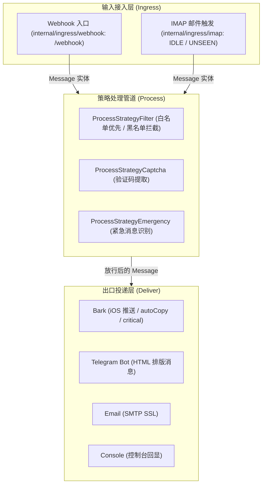

# AGENTS.md — working notes for coding agents (and humans)

本文档是任何人类工程师或 AI 智能体修改本仓库代码时的**单源事实标准 (Single Source of Truth)**。在改动任何代码前必须通读此文件。若文档描述与代码事实冲突，以代码为准并在同一次改动中更新本文档。

---

### 项目定位 (Purpose)

`push-transfer` 是一个面向个人/自建场景的**通知中转与过滤网关**。主要接收来自移动设备（如 Android 端的 SmsForwarder 等转发应用）上报的短信和来电事件，经过白名单放行、黑名单过滤、验证码识别及紧急消息标记后，将格式化消息多路分发至 Bark (iOS APNs)、Telegram、邮件等终端。

---

### 系统架构与文件职责 (Architecture)

系统采用典型的「输入端适配 (Ingress) → 策略流水线 (Process) → 多渠道投递 (Deliver)」三层设计：



> 历史 Python 实现 (`shell/*.py`) 已整体移除，仅保留在 git 历史中；当前仓库**只有 Go 实现**。

#### 文件职责清单

| 目录 / 文件 | 职责 | 核心依赖 / 规范 |
|------------|------|----------------|
| `cmd/push-transfer/main.go` | 程序入口与组装根。负责 CLI 参数解析 (`-v`/`-version`/`-h`，`-h` 退出码为 0)、显式结构化日志 (`*slog.Logger`) 全链路依赖注入（基于 `slog.LevelVar` 支持 `LOG_LEVEL` 动态级别，无全局 `slog.SetDefault` 污染）、`RUN_MODE` 必填运行模式状态机 (`resolveRunModes`：`webhook`/`imap`/`both`) 与**「无凭据不得对外服务 Webhook」的 fail-fast 启动门禁**（仅 `RUN_MODE=imap` 纯 IMAP 模式可无凭据运行，且该模式下禁止配置 `AUTH_CREDENTIALS`）、跨源共享并发安全内存去重缓存单例 (`internal/idempotency.MemoryCache`) 生命周期管理 (`rootCtx` 纳管与优雅退出 `Close()`)、`TIMEZONE`/`TZ` 进程时区配置与 Webhook/IMAP 输入端显式注入、HTTP Server 防御性超时工厂 (`newHTTPServer`)、后台协程生命周期对称纳管 (`WaitGroup`)、半配置/弃用项告警与平滑停机。 | `log/slog`, `net/http` |
| `internal/config/` | 运行时配置中心 (SSoT)。强类型读取环境变量，支持解耦注入 (`LoadFromLookup`)、默认值容错、`RUN_MODE` 枚举语法校验 (`webhook`/`imap`/`both`)、`LOG_LEVEL` 日志级别语法校验 (`debug`/`info`/`warn`/`error`，默认 `info`)、`TIMEZONE`/`TZ` 时区语法校验（支持 IANA 标准时区与各类 UTC 偏移量格式，非法值 fail-fast）、去重配置解析 (`IDEMPOTENCY_TTL` 门禁区间 `[1s, 24h]` 与 `IDEMPOTENCY_MAX_KEYS` 正整数门禁，非法值 fail-fast）、可选通道按需启用/半配置检测 (`Enabled`/`HasPartialConfig`)、`BARK_GET_URL` 向后兼容推导 `PostURL`、`AUTH_CREDENTIALS` 多凭据严格解析（**Webhook 凭据的唯一来源**：V1–V11 校验、name 唯一性、认证要素唯一性，以及 `Credential.Factors()`/`Usable()` 单一可用性判定）。 | 标准库 |
| `internal/model/` | 核心领域模型。定义强类型 `MsgType` 枚举与合法性校验 (`Valid()`)、`Message` 实体（含 `AppName`、`Hostname`、`TimeSensitive` 与 `IdempotencyKey` 字段，前后自动 `TrimSpace` 并通过 `truncateRunes` 限长 256 Rune 安全截断，并通过 `parseBatteryLevel` 保持 `*int` 指针契约且自适应解析数值/百分比/浮点字符串，通过 `parseFlexibleBool` 让 `time_sensitive` 与 `emergency` 保持 `bool` 契约且自适应解析布尔值、数值、英文字符串 `true`/`false`/`yes`/`no`/`1`/`0` 与本地化中文 `"是"`/`"否"`/`"真"`/`"假"`/`"对"`/`"错"`）、多渠道对称排版 (`GenComplexText()` 支持设备元数据四态排版与换行防注入，自动优先继承输入携带的显式时区，避免容器默认零时区冲刷)、具备防崩溃防御性解析的 `FlexibleTimestamp`（支持秒/毫秒/字符串数字/ISO 8601 全变体/RFC 5322/2822 日期串，负例降级为 0）、多级时间戳兜底回退 (`firstValidTimestamp`) 与并发深拷贝隔离 (`Message.Clone()`)。 | 标准库 |
| `internal/pipeline/` | 策略处理流水线。基于 `regexp2` 支持高级零宽断言与 ReDoS 超时截断，将 `MsgTypeText` 与 `MsgTypeAppNotification` 并列纳管，执行白名单放行、黑名单拦截、验证码第1捕获组提取（命中非空验证码单向富化 `TimeSensitive = true`）与紧急呼叫标记（支持各阶段 debug 诊断日志），对未定义类型实行 Fail-Closed 错误拦截。 | `github.com/dlclark/regexp2` |
| `internal/idempotency/` | 跨输入源共享内存去重引擎。提供原子 `CheckAndRecord(key string) bool`（Check-and-Set 防并发竞态）、惰性与周期双轨淘汰机制、存活率低时触发 Map 紧缩重建（Compaction）回收哈希桶内存、容量上限常量时间淘汰防 OOM、以及支持显式 `Close()` 与 `context` 协程退出保障。 | 标准库 `sync`, `time` |
| `internal/deliver/` | 并发分发出口。通过 `Dispatcher` 克隆消息副本 (`Message.Clone()`) 扇出并发分发并记录各渠道耗时与成功 debug 日志；提供共享调优连接池 (`NewDefaultHTTPClient`)；实现 Bark (AES-128-CBC + 每消息随机 IV，且按 Bark 官方协议把 `iv` 与 `ciphertext` 作为两个独立顶层参数发送；智能两段式 `group` 分组状态机与四态标题组装；严格三态优先级 `Emergency (critical) > TimeSensitive (timeSensitive) > 默认不传`，显式排除 `hostname`；多设备/多 URL 二级并发扇出；支持响应体 debug 日志)、Telegram Bot API (HTML 实体安全截断 + 校验响应体 `ok` 字段而非仅看 HTTP 状态码 + 响应 debug 日志)、SMTP SSL 邮件投递 (RFC 2047 标题编码 + 四态主题组装 + CRLF 注入清洗 + 会话全链路 Deadline + 投递 debug 日志) 与 Console 结构化回显（含 `app_name`、`hostname`、`time_sensitive` 与 `text`）。 | 标准库 `net/http`, `crypto/aes`, `mime` |
| `internal/ingress/webhook/` | HTTP Webhook 输入端。提供 `/webhook` 与 `/healthz`，实现 1MB 请求体上限 (`http.MaxBytesReader` 防 OOM DoS 返回 `413`)、`LOG_LEVEL=debug` 下记录请求原始 JSON 与解析后的实体字段、认证失败阶段诊断（恒定时间比较且凭据本体永不泄露）、`msg_type` 合法性强制门禁校验（非法/缺失直接 Fail-Fast 返回 `400`）、`IdempotencyChecker` 局部接口解耦接入与重复请求短路返回 HTTP 200 `{"status":"success"}`（审计日志记录）、可信代理边界真实 IP 提取 (`GetRealIP` 仅信任 Loopback/Private 或 `TrustedProxies` 并校验 IP 格式)、多凭据 Bearer Token + HTTP Basic Auth 恒定时间鉴权（SHA-256 预计算摘要 + 每请求固定 3 次哈希 + 全量扫描整数位运算汇聚，`crypto/subtle`）、`401` 时按 RFC 9110 返回 `WWW-Authenticate: Basic` 质询、`X-Forwarded-For` 自右向左跳过受信代理取首个非受信地址，与标准状态码响应。 | 标准库 `net/http`, `crypto/subtle` |
| `internal/ingress/imap/` | IMAP 邮件触发输入端。基于 `go-imap/v2` 实现长连接 IDLE 与 TLS 拨号超时控制、自定义邮箱目录 (`EMAIL_TRIGGER_MAILBOX`)、至少一次消费语义（Handler 失败保留 `UNSEEN` 并通过会话内非断连指数退避定时器重试）、毒丸死信隔离（损坏 JSON 标记 `\Seen` 防阻塞，但**主题不匹配的普通邮件一律保持原样、绝不改写未读状态**并在 debug 日志记录主题）、触发邮件解析结果 debug 诊断、成功会话后重连退避计数归零与 RFC 2047 MIME 多段安全解码。 | `github.com/emersion/go-imap/v2` |
| `internal/crypto/` | 安全加密底层。提供 Bark AES-128-CBC 每消息随机 IV 加密（返回 `BarkPayload{Ciphertext, IV}`，对应 Bark 的 `ciphertext`/`iv` 两个独立顶层参数）、16 字符 ASCII IV 生成、以及常量时间校验的 PKCS#7 填充/去填充。 | `crypto/aes`, `crypto/cipher` |
| `test/e2e/` | 端到端黑盒与系统集成测试套件。独立编译二进制子进程，利用内存动态 TLS CA/证书生成与注入提供 Mock Bark、Telegram、真实 TLS SMTP 与真实 TLS IMAP 服务端，测试全渠道投递闭环、多凭据鉴权、优雅停机、毒丸死信隔离与混合流量高并发压测（`TestE2E_HighConcurrency_Stress_Report`）。 | 标准库 `net/http`, `crypto/x509`, `syscall` |

---

### 核心契约与红线规范 (Contracts & Invariants)

在对本仓库进行任何维护或修改时，**严禁违背以下契约**：

1. **严禁在日志与回显中使用外部 Shell (无 `os.system`)**：
   - 外部传入的短信内容、发件人等属于不可信输入。**绝对禁止**将 `msg.content` 或任何变量直接拼接到 `os.system` / `echo` 中执行，避免产生远程命令执行 (RCE) 漏洞。日志输出必须统一使用结构化日志 (`log/slog`)。
2. **时间戳容错、多级回退与并发副本隔离**：
   - 移动端上报的时间戳可能为 `None`/`null`，或为 13 位毫秒级时间戳、ISO 8601 格式化日期字符串（含本地时间/逗号小数秒/时区偏移）或 RFC 5322 / RFC 2822 邮件日期字符串。必须防御空值与非法格式（非法值静默降级为 `0`），在时间戳大于 `1e11` 时自动转为秒，通过多级候选字段回退 (`IncomingTime`/`TransmitTime`/`ReceiveTime`/`SendTime`/`Timestamp`) 渲染时间；若输入时间携带显式时区（如 `+08:00`），排版时自动优先继承输入时区（避免运行环境默认 UTC 零时区导致时间漂移）；若输入未带显式时区，由运行时配置 `TIMEZONE` / `TZ` 注入的 `TimeLocation` 作为兜底；电量字段 `battery_level` 自适应解析数值、百分比与浮点字符串并严格保留 `*int` 指针契约（空串/非法值降级为 `nil`，不误报 0%）；时效性字段 `time_sensitive` 与紧急字段 `emergency` 保持 `bool` 契约并兼容原生布尔值（`true`/`false`）、数值（`1`/`0`、`1.0`/`0.0`）、英文字符串（`"true"`/`"false"`、`"1"`/`"0"`、`"yes"`/`"no"`、`"y"`/`"n"`、`"on"`/`"off"`、`"enable"`/`"disable"`）以及本地化中文（`"是"`/`"否"`、`"真"`/`"假"`、`"对"`/`"错"`，非法值安全降级为 `false`）；外部输入的 `hostname` 拼入正文前必须通过 `sanitizeSingleLine` 清洗换行与控制字符防注入；并发分发时必须通过 `msg.Clone()` 隔离各下游通道的实体副本。
3. **安全比较与多凭据鉴权 (Timing Attack Defense)**：
   - 认证凭据（Bearer Token、HTTP Basic Auth 用户名与密码）比对必须使用恒定时间比较（`crypto/subtle.ConstantTimeCompare`），禁止使用 `==` 进行裸字符串比对。多凭据集合必须全量扫描、不得提前 return，比较次数与输入无关，并由注入计数 comparer 的测试固化。`name`/`token` 剥离首尾空白，Basic `username`/`password` 不做 trim、按原值逐字节比对（RFC 7617 §2.1）。
   - **凭据本体永不进入日志与诊断信息**：配置校验错误、启动告警、审计日志与回显只允许出现变量名、条目序号、出错字段名与 `Credential.Name`；**严禁**把 token / 口令原文（含 `AUTH_CREDENTIALS` 整串 JSON）拼进 `error` / `WARN` 文案，避免密钥经日志泄漏。因 `main()` 会把配置错误交给 `slog.Error` 落盘，该约束同样适用于 `internal/config` 的失败路径。
   - **不存在无鉴权服务模式**：运行模式由必填枚举 `RUN_MODE`（`webhook` / `imap` / `both`）显式声明，未设置或非法值必须 fail-fast。Webhook 凭据只有 `AUTH_CREDENTIALS` 一个来源（旧版 `RUN_TRIGGER` / `AUTH_TOKEN` / `AUTH_USERNAME` + `AUTH_PASSWORD` 已移除，**不得**以兼容名义加回）。进程若需要对外提供 HTTP Webhook（`RUN_MODE=webhook` 或 `both`）却没有任何有效凭据，必须在启动时 fail-fast 退出，**严禁**退化为「未配置即放行」；唯一允许无凭据运行的是 `RUN_MODE=imap` 的纯 IMAP 模式（不监听任何 HTTP 端口，且若在该模式下配置 `AUTH_CREDENTIALS` 同样必须 fail-fast 报错）。`Handler` 侧同时保留 fail-closed 兜底：凭据集合为空的处理器必须拒绝所有请求。
4. **网络 I/O 必须显式声明全链路超时与请求体上限 (Timeout & MaxBytes)**：
   - 所有的外部网络调用（HTTP Client/Server、SMTP 建连与协议交互 `conn.SetDeadline`、IMAP TLS 拨号与 IDLE、Telegram/Bark 调用）必须显式指定超时，Webhook 请求体必须通过 `http.MaxBytesReader` 限制体积（默认 1MB），防止慢速攻击、对端挂起或超大请求导致进程阻塞或 OOM。
5. **事件循环与并发边界清晰**：
   - 所有后台服务协程（IMAP Listener 与 HTTP Webhook Server）必须对称纳入 `sync.WaitGroup` 生命周期管理，且严禁在实例运行期调用 `slog.SetDefault` 污染全局状态。
6. **HTTP 状态码与 IMAP 消费语义符合真实状态**：
   - `/webhook` 在认证失败时必须返回 `401`；JSON 解析失败返回 `400`；请求体超限返回 `413`；投递下游全部失败或不可恢复错误返回 `5xx`。IMAP 触发器在下游投递失败时必须保留 `UNSEEN` 状态并在会话内退避重试，仅在投递成功或确认为永久损坏的毒丸邮件时标记 `\Seen`。
7. **配置单源事实 (SSoT) 与按需加载**：
   - 避免将可选投递方式置于强依赖中；未启用的通道不应阻断服务启动，半配置通道或已弃用配置（如 `AES_128_ECB_IV`）应在启动时输出明确的 `WARN` 结构化日志。新增、调整或**移除**环境变量时，必须同批更新 `.env.example` 与 README 文档，并在本文件同步，保持单源事实闭环。**唯一例外**：Webhook 对外服务所需的凭据缺失属致命错误，必须 fail-fast 而非仅告警。
8. **跨输入源原子幂等与优雅忽略语义 (Idempotency & Deduplication)**：
   - 跨输入源（Webhook 与 IMAP）共享并发安全的内存去重缓存单例 (`internal/idempotency.MemoryCache`)。消息载荷支持可选字段 `idempotency_key`（自动 `TrimSpace` 并限长 256 Rune 安全截断；空 key 恒放行）。
   - 准入层必须在消息认证与 `msg.MsgType.Valid()` 校验通过后方可执行去重判定（非法请求坚决返回 400，绝不占位缓存防缓存污染）。
   - 判定重复时实行统一优雅忽略语义：Webhook 直接短路并返回 HTTP 200 `{"status":"success"}` 并输出 INFO 审计日志（防止客户端因非 200 状态码反复重试轰炸）；IMAP 邮件触发器跳过后续策略流水线与投递出口，直接标记邮件已读 `\Seen` 并返回 `nil`，输出 INFO 审计日志（防止未读邮件死循环重复拉取消费）。
   - 缓存引擎双轨淘汰与周期 Map 紧缩（Compaction）回收底层哈希桶内存，杜绝内存泄漏；后台协程生命周期由 `rootCtx` 与显式 `Close()` 对称纳管，杜绝 Goroutine 泄漏。

---

### 关键代码陷阱与已审计问题 (Known Pitfalls)

> 说明：`docs/` 已被 `.gitignore` 排除（本地审计记录，不随仓库分发），因此下列链接仅在本地工作副本中存在。

完整且详细的代码审计条目、复现机理与整改路线见文档 [`docs/audit-report.md`](./docs/audit-report.md)、[`docs/go-architecture-audit.md`](./docs/go-architecture-audit.md) 与 [`docs/remediation-plan.md`](./docs/remediation-plan.md)；对应的 Go 语言重构演进设计方案见 [`docs/go-migration-plan.md`](./docs/go-migration-plan.md)；多凭据鉴权架构设计方案见 [`docs/auth-multi-credentials-design.md`](./docs/auth-multi-credentials-design.md)。

Python 历史实现已于本次改动整体移除（`shell/*.py` 只存在于 git 历史），但下列历史缺陷正是上面「核心契约」的由来，维护时**不得回退**：

- **RCE 漏洞（原 `utils.py`）**: `print_with_time` 拼接 `os.system(f'echo "... {content}"')`，任何含反引号、分号、`$()` 的短信都会触发服务端任意代码执行。现由 `log/slog` 结构化日志替代。
- **静态 IV 复用（原 `deliver.py`）**: 名为 ECB 实为 CBC，且 IV 来自配置恒定不变，破坏加密机密性。现为每消息随机 IV，`iv` 与 `ciphertext` 作为两个独立顶层参数下发。
- **IMAP 忙等死循环（原 `trigger.py`）**: 异常分支无退避直接重试，断网时 100% CPU 并易被邮件服务商封号。现为 IDLE 长连接 + 指数退避（含抖动）。
- **邮件主题多段解码截断（原 `trigger.py`）**: `decode_header` 仅取 `[0]`，丢弃多段 RFC 2047 主题且遇 `None` 抛 `TypeError`。现为多段安全解码。
- **验证码捕获组丢失（原 `process.py`）**: 只取整体匹配，正则捕获组失效。现优先读取第 1 捕获组。
- **策略映射常量拼写（原 `process.py`）**: `strategy_map` 误用投递目标常量作为处理策略 key。现为按 `MsgType` 显式分支。
- **启动脚本自毁风险（原 `init.py`）**: 全量 `pip install -U`、硬编码 `/root/shell`、对 import 做正则安装。现由标准二进制/容器镜像与 `.env` 声明式配置替代。

---

### 如何验证代码改动 (Verification)

在声称“完成/修好”之前，必须真实执行验证命令并输出结果。

#### 构建、静态检查与单元测试

```bash
# 1. 静态单二进制构建
go build -v -o push-transfer ./cmd/push-transfer

# 2. 严格代码质量与静态检查 (必须保持 0 issues)
golangci-lint run ./...   # 配置为 v2 格式；同时校验 gofmt（formatters.gofmt）
gofmt -l .                # 必须无输出
go vet ./...              # 必须无输出

# 3. 运行全量单元测试、端到端测试与并发竞态检测 (-race)
go test -race -cover ./...

# 4. 运行全模块微基准性能测试
go test -bench=. -benchtime=10ms -run=^$ ./internal/...
```

#### CI 与镜像发布流水线

- **自动化测试与静态检查**：由 GitHub Actions 在每次 push 与 pull request 时自动执行，
  流水线定义见 [`.github/workflows/ci.yml`](.github/workflows/ci.yml)，包含 gofmt/vet
  校验、单元与端到端测试 `go test -race -cover`、性能基准冒烟测试及 `golangci-lint run`。**本地验证通过不等于 CI 通过**，
  合并前必须以 CI 绿色为准。
- **容器镜像发布**：由 GitHub Actions 在推送版本 Tag（`v*` 或 `[0-9]*`）时自动触发，
  流水线定义见 [`.github/workflows/release-image.yml`](.github/workflows/release-image.yml)。
  支持 `linux/amd64` 与 `linux/arm64` 双架构构建，提取 semver 与 ref metadata 并附带
  SBOM 与 build provenance 签名信息，多架构镜像自动发布至 GHCR (`ghcr.io/zapsaang/push-transfer`)。

---

### 智能体操作守则 (House Rules for AI Agents)

1. **先读再改**：动手修改任何模块前，先读完关联模块的实现与调用链路。
2. **最小侵入**：与现有项目结构与代码风格保持一致，不要引入非必要的外部重型框架或未经要求的重构。
3. **真实验证**：提交改动前必须给出验证命令和输出日志，杜绝未经实测的猜测。
4. **单源纪律**：环境变量必须统一通过 `.env.example` 声明文档化，禁止在代码或配置中硬编码敏感 Key/Token。
