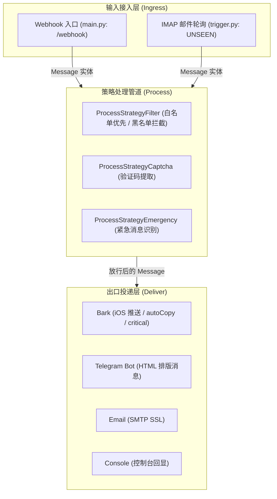

# AGENTS.md — working notes for coding agents (and humans)

本文档是任何人类工程师或 AI 智能体修改本仓库代码时的**单源事实标准 (Single Source of Truth)**。在改动任何代码前必须通读此文件。若文档描述与代码事实冲突，以代码为准并在同一次改动中更新本文档。

---

### 项目定位 (Purpose)

`push-transfer` 是一个面向个人/自建场景的**通知中转与过滤网关**。主要接收来自移动设备（如 Android 端的 SmsForwarder 等转发应用）上报的短信和来电事件，经过白名单放行、黑名单过滤、验证码识别及紧急消息标记后，将格式化消息多路分发至 Bark (iOS APNs)、Telegram、邮件等终端。

---

### 系统架构与文件职责 (Architecture)

系统采用典型的「输入端适配 (Ingress) → 策略流水线 (Process) → 多渠道投递 (Deliver)」三层设计：



#### 文件职责清单

| 文件 | 职责 | 核心依赖 / 规范 |
|------|------|----------------|
| `shell/main.py` | HTTP 服务入口与路由挂载。提供 `/webhook` 接口，负责反向代理头适配 (`ProxyFix`)、Token 校验与流程串联。 | Flask, ProxyFix |
| `shell/trigger.py` | 主动拉取入口。通过 IMAP SSL 定期轮询未读邮件，解包邮件主题与正文并转入处理管道。 | `imaplib`, `email`, 后台 `deliver_loop` 线程 |
| `shell/process.py` | 消息处理策略管道。实现白名单/黑名单过滤 (`Filter`)、验证码提取 (`Captcha`)、紧急呼叫识别 (`Emergency`)。 | 策略模式，基于 `re` |
| `shell/deliver.py` | 消息分发出口。实现 Bark HTTP 推送、Telegram Bot API 发送、SMTP 邮件发送及控制台打印。 | `requests`, `python-telegram-bot`, `smtplib` |
| `shell/model.py` | 统一数据契约。定义 `Message` 数据载体，封装来电/短信的时间、电量、内容、验证码与紧急状态。 | 纯数据模型 |
| `shell/auth.py` | 认证装饰器。提供基于 HTTP Basic 的 `requires_login` 与 Bearer Token/Query 的 `requires_token`。 | Flask 装饰器 |
| `shell/env.py` | 运行配置中心。启动时强校验读取环境变量，不落地任何明文密钥。 | `os.environ`, `json` |
| `shell/consts.py` | 全局常量与策略路由映射表。定义消息类型、各类型启用的策略链路和分发目标。 | 纯配置映射 |
| `shell/utils.py` | 基础工具函数。异步包装、时间戳格式化、布尔转换。 | 基础工具 |
| `shell/response.py` | 统一 HTTP 响应封装。标准化成功与失败返回结构。 | 纯函数 |
| `shell/init.py` | **历史遗留的容器启动引导脚本**。存在严重设计缺陷与路径硬编码，不建议继续扩展。 | 应逐步废弃并替换为标准声明式管理 |

---

### 核心契约与红线规范 (Contracts & Invariants)

在对本仓库进行任何维护或修改时，**严禁违背以下契约**：

1. **严禁在日志与回显中使用外部 Shell (无 `os.system`)**：
   - 外部传入的短信内容、发件人等属于不可信输入。**绝对禁止**将 `msg.content` 或任何变量直接拼接到 `os.system` / `echo` 中执行，避免产生远程命令执行 (RCE) 漏洞。日志输出必须统一使用 Python 标准 `logging` 模块或内建 `print()`。
2. **时间戳容错与类型防御**：
   - 移动端上报的时间戳可能为 `None`，或为 13 位毫秒级时间戳。`get_date_time` 必须防御 `None`，并在时间戳大于 `1e11` 时自动转为秒，严禁直接 `datetime.fromtimestamp(None)` 导致崩溃。
3. **安全比较 (Timing Attack Defense)**：
   - 认证凭据（Token、密码）比对必须使用 `hmac.compare_digest`，禁止使用 `==` 进行裸字符串比对。
4. **网络 I/O 必须显式声明超时 (Timeout)**：
   - 所有的外部网络调用（`requests.post`、`smtplib`、IMAP 连接、Telegram 调用）必须显式指定 `timeout`（建议 5~10 秒），防止网络波动或对端挂起导致 Worker 进程永久阻塞。
5. **事件循环与异步边界清晰**：
   - 不要在 `async def` 协程函数中混入同步阻塞的网络调用（如同步 `requests`、`smtplib`）。若暂未迁移至 `httpx`/`aiohttp`/`aiosmtplib`，必须使用 `async_wrap` / `run_in_executor` 扔进线程池执行，严禁阻塞 asyncio 事件循环。
6. **HTTP 状态码符合真实语义**：
   - `/webhook` 在认证失败时必须返回 `401`；JSON 解析失败返回 `400`；投递下游全部失败或不可恢复错误应返回 `5xx`，避免返回 `200` 导致上游转发器误判成功而丢失重发机会。
7. **配置按需读取与解耦**：
   - 避免将所有可选投递方式全部置于 `_required_str` 强依赖中；未启用的通道（如用户未配置 Telegram）不应阻断整个服务启动。

---

### 关键代码陷阱与已审计问题 (Known Pitfalls)

完整且详细的代码审计条目、复现机理与整改路线见文档 [`docs/audit-report.md`](./docs/audit-report.md)。以下为维护和重构时必须逐一注意的关键陷阱：

- **RCE 漏洞 (utils.py)**: `print_with_time` 中含有 `os.system(f'echo "... {content}"')`，任何包含反引号、分号、`$()` 的短信都会导致服务端任意代码执行。
- **静态 IV 复用 (deliver.py)**: `crypt_for_bark` 命名为 ECB 但使用了 CBC 模式，且从配置中读取静态固定的 IV。CBC 模式必须使用随机 IV，复用 IV 破坏加密机密性。
- **IMAP 忙等死循环 (trigger.py)**: `_waiting_for_email_sync` 异常捕获块未设置任何延时直接重新循环，网络断开时会导致 100% CPU 忙等与邮件服务器封号。同时每秒轮询容易被识别为滥用。
- **邮件主题多段解码截断 (trigger.py)**: `decode_header` 返回值为解码分段列表，仅取 `[0]` 会丢失主题后续文字；遇 `None` 时会抛出 TypeError。
- **验证码提取捕获组丢失 (process.py)**: `captcha_code.group()` 仅取整串匹配；当正则声明了捕获组（如 `r'验证码[是为：:]\s*(\d{4,6})'`）时，应优先读取 `group(1)`。
- **策略映射常量拼写 (process.py)**: `strategy_map` 错误使用了 `consts.ENUM_DELIVER_TARGET_DEFAULT` 作为处理策略的 key。
- **启动脚本自毁风险 (init.py)**: 启动时全量 `pip install -U`、硬编码 `/root/shell` 路径，并对 `main.py` 的 import 做正则安装，属于严重违背可复现环境与单源纪律的历史代码，应重构为标准化配置。

---

### 如何验证代码改动 (Verification)

在声称“完成/修好”之前，必须真实执行验证命令并输出结果。

#### 1. 语法与静态检查
```bash
# 检查所有 Python 脚本语法
python3 -m py_compile shell/*.py
```

#### 2. 安全与逻辑单测 (离线验证)
可在本地运行 mock 单测，验证关键修复（如命令注入消除、时间戳兼容、邮件解码等）：
```bash
# 验证 utils.print_with_time 不再调用外部 shell
python3 -c "import sys; sys.path.append('shell'); import utils; utils.print_with_time('safe_test; id')"

# 验证 get_date_time 容错
python3 -c "import sys; sys.path.append('shell'); import utils; print(utils.get_date_time(None)); print(utils.get_date_time(1729000000000))"
```

---

### 智能体操作守则 (House Rules for AI Agents)

1. **先读再改**：动手修改任何模块前，先读完关联模块的实现与调用链路。
2. **最小侵入**：与现有项目结构与代码风格保持一致，不要引入非必要的外部重型框架或未经要求的重构。
3. **真实验证**：提交改动前必须给出验证命令和输出日志，杜绝未经实测的猜测。
4. **单源纪律**：环境变量必须统一通过 `.env.example` 声明文档化，禁止在代码或配置中硬编码敏感 Key/Token。
