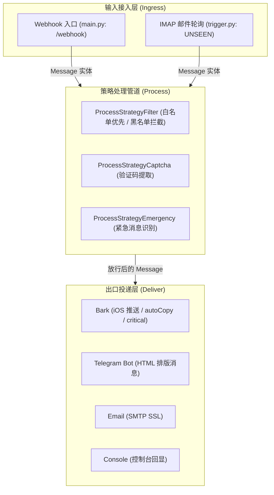

# AGENTS.md — working notes for coding agents (and humans)

本文档是任何人类工程师或 AI 智能体修改本仓库代码时的**单源事实标准 (Single Source of Truth)**。在改动任何代码前必须通读此文件。若文档描述与代码事实冲突，以代码为准并在同一次改动中更新本文档。

---

### 项目定位 (Purpose)

`push-transfer` 是一个面向个人/自建场景的**通知中转与过滤网关**。主要接收来自移动设备（如 Android 端的 SmsForwarder 等转发应用）上报的短信和来电事件，经过白名单放行、黑名单过滤、验证码识别及紧急消息标记后，将格式化消息多路分发至 Bark (iOS APNs)、Telegram、邮件等终端。

---

### 系统架构与文件职责 (Architecture)

系统采用典型的「输入端适配 (Ingress) → 策略流水线 (Process) → 多渠道投递 (Deliver)」三层设计：



#### 文件职责清单 (Python 历史实现与参考)

| 文件 | 职责 | 核心依赖 / 规范 |
|------|------|----------------|
| `shell/main.py` | HTTP 服务入口与路由挂载。提供 `/webhook` 接口，负责反向代理头适配 (`ProxyFix`)、Token 校验与流程串联。 | Flask, ProxyFix |
| `shell/trigger.py` | 主动拉取入口。通过 IMAP SSL 定期轮询未读邮件，解包邮件主题与正文并转入处理管道。 | `imaplib`, `email`, 后台 `deliver_loop` 线程 |
| `shell/process.py` | 消息处理策略管道。实现白名单/黑名单过滤 (`Filter`)、验证码提取 (`Captcha`)、紧急呼叫识别 (`Emergency`)。 | 策略模式，基于 `re` |
| `shell/deliver.py` | 消息分发出口。实现 Bark HTTP 推送、Telegram Bot API 发送、SMTP 邮件发送及控制台打印。 | `requests`, `python-telegram-bot`, `smtplib` |
| `shell/model.py` | 统一数据契约。定义 `Message` 数据载体，封装来电/短信的时间、电量、内容、验证码与紧急状态。 | 纯数据模型 |
| `shell/auth.py` | 认证装饰器。提供基于 HTTP Basic 的 `requires_login` 与 Bearer Token/Query 的 `requires_token`。 | Flask 装饰器 |
| `shell/env.py` | 运行配置中心。启动时强校验读取环境变量，不落地任何明文密钥。 | `os.environ`, `json` |
| `shell/consts.py` | 全局常量与策略路由映射表。定义消息类型、各类型启用的策略链路和分发目标。 | 纯配置映射 |
| `shell/utils.py` | 基础工具函数。异步包装、时间戳格式化、布尔转换。 | 基础工具 |
| `shell/response.py` | 统一 HTTP 响应封装。标准化成功与失败返回结构。 | 纯函数 |
| `shell/init.py` | **历史遗留的容器启动引导脚本**。存在严重设计缺陷与路径硬编码，不建议继续扩展。 | 应逐步废弃并替换为标准声明式管理 |

#### 文件职责清单 (Go 现代化生产架构 - 推荐)

| 目录 / 文件 | 职责 | 核心依赖 / 规范 |
|------------|------|----------------|
| `cmd/push-transfer/main.go` | 程序入口与组装根。负责 CLI 参数解析 (`-v`/`-version`/`-h`，`-h` 退出码为 0)、显式结构化日志 (`*slog.Logger`) 全链路依赖注入（无全局 `slog.SetDefault` 污染）、HTTP Server 防御性超时工厂 (`newHTTPServer`)、后台协程生命周期对称纳管 (`WaitGroup`)、半配置/弃用项告警与平滑停机。 | `log/slog`, `net/http` |
| `internal/config/` | 运行时配置中心 (SSoT)。强类型读取环境变量，支持解耦注入 (`LoadFromLookup`)、默认值容错、可选通道按需启用/半配置检测 (`Enabled`/`HasPartialConfig`)、`BARK_GET_URL` 向后兼容推导 `PostURL` 与 Webhook 双鉴权配置解析。 | 标准库 |
| `internal/model/` | 核心领域模型。定义 `Message`、具备防崩溃防御性解析的 `FlexibleTimestamp`（容错毫秒/非数字/null/负值）、多级时间戳兜底回退 (`firstValidTimestamp`) 与并发深拷贝隔离 (`Message.Clone()`)。 | 标准库 |
| `internal/pipeline/` | 策略处理流水线。基于 `regexp2` 支持高级零宽断言与 ReDoS 超时截断，执行白名单放行、黑名单拦截、验证码第1捕获组提取与紧急呼叫标记。 | `github.com/dlclark/regexp2` |
| `internal/deliver/` | 并发分发出口。通过 `Dispatcher` 克隆消息副本 (`Message.Clone()`) 扇出并发分发；提供共享调优连接池 (`NewDefaultHTTPClient`)；实现 Bark (AES-128-CBC + 每消息随机 IV，且按 Bark 官方协议把 `iv` 与 `ciphertext` 作为两个独立顶层参数发送；多设备/多 URL 二级并发扇出)、Telegram Bot API (HTML 实体安全截断 + 校验响应体 `ok` 字段而非仅看 HTTP 状态码)、SMTP SSL 邮件投递 (RFC 2047 标题编码 + CRLF 注入清洗 + 会话全链路 Deadline) 与 Console 回显。 | 标准库 `net/http`, `crypto/aes`, `mime` |
| `internal/ingress/webhook/` | HTTP Webhook 输入端。提供 `/webhook` 与 `/healthz`，实现 1MB 请求体上限 (`http.MaxBytesReader` 防 OOM DoS 返回 `413`)、可信代理边界真实 IP 提取 (`GetRealIP` 仅信任 Loopback/Private 或 `TrustedProxies` 并校验 IP 格式)、Bearer Token（含 `?token=` 查询参数兼容）+ HTTP Basic Auth 恒定时间双鉴权 (`crypto/subtle`)、`401` 时按 RFC 9110 返回 `WWW-Authenticate: Basic` 质询、`X-Forwarded-For` 自右向左跳过受信代理取首个非受信地址，与标准状态码响应。 | 标准库 `net/http`, `crypto/subtle` |
| `internal/ingress/imap/` | IMAP 邮件触发输入端。基于 `go-imap/v2` 实现长连接 IDLE 与 TLS 拨号超时控制、自定义邮箱目录 (`EMAIL_TRIGGER_MAILBOX`)、至少一次消费语义（Handler 失败保留 `UNSEEN` 并通过会话内非断连指数退避定时器重试）、毒丸死信隔离（损坏 JSON 标记 `\Seen` 防阻塞，但**主题不匹配的普通邮件一律保持原样、绝不改写未读状态**）、成功会话后重连退避计数归零与 RFC 2047 MIME 多段安全解码。 | `github.com/emersion/go-imap/v2` |
| `internal/crypto/` | 安全加密底层。提供 Bark AES-128-CBC 每消息随机 IV 加密（返回 `BarkPayload{Ciphertext, IV}`，对应 Bark 的 `ciphertext`/`iv` 两个独立顶层参数）、16 字符 ASCII IV 生成、以及常量时间校验的 PKCS#7 填充/去填充。 | `crypto/aes`, `crypto/cipher` |

---

### 核心契约与红线规范 (Contracts & Invariants)

在对本仓库进行任何维护或修改时，**严禁违背以下契约**：

1. **严禁在日志与回显中使用外部 Shell (无 `os.system`)**：
   - 外部传入的短信内容、发件人等属于不可信输入。**绝对禁止**将 `msg.content` 或任何变量直接拼接到 `os.system` / `echo` 中执行，避免产生远程命令执行 (RCE) 漏洞。日志输出必须统一使用结构化日志 (`log/slog`)、Python 标准 `logging` 模块或内建 `print()`。
2. **时间戳容错、多级回退与并发副本隔离**：
   - 移动端上报的时间戳可能为 `None`/`null`，或为 13 位毫秒级时间戳。必须防御空值并在时间戳大于 `1e11` 时自动转为秒，通过多级候选字段回退 (`IncomingTime`/`TransmitTime`/`ReceiveTime`/`SendTime`/`Timestamp`) 渲染时间；并发分发时必须通过 `msg.Clone()` 隔离各下游通道的实体副本。
3. **安全比较与双鉴权 (Timing Attack Defense)**：
   - 认证凭据（Bearer Token、HTTP Basic Auth 用户名与密码）比对必须使用恒定时间比较（Go `crypto/subtle.ConstantTimeCompare` / Python `hmac.compare_digest`），禁止使用 `==` 进行裸字符串比对。
4. **网络 I/O 必须显式声明全链路超时与请求体上限 (Timeout & MaxBytes)**：
   - 所有的外部网络调用（HTTP Client/Server、SMTP 建连与协议交互 `conn.SetDeadline`、IMAP TLS 拨号与 IDLE、Telegram/Bark 调用）必须显式指定超时，Webhook 请求体必须通过 `http.MaxBytesReader` 限制体积（默认 1MB），防止慢速攻击、对端挂起或超大请求导致进程阻塞或 OOM。
5. **事件循环与并发边界清晰**：
   - Go 实现中所有后台服务协程（IMAP Listener 与 HTTP Webhook Server）必须对称纳入 `sync.WaitGroup` 生命周期管理，且严禁在实例运行期调用 `slog.SetDefault` 污染全局状态；Python 历史实现中严禁在 `async def` 协程函数中混入同步阻塞网络调用。
6. **HTTP 状态码与 IMAP 消费语义符合真实状态**：
   - `/webhook` 在认证失败时必须返回 `401`；JSON 解析失败返回 `400`；请求体超限返回 `413`；投递下游全部失败或不可恢复错误返回 `5xx`。IMAP 触发器在下游投递失败时必须保留 `UNSEEN` 状态并在会话内退避重试，仅在投递成功或确认为永久损坏的毒丸邮件时标记 `\Seen`。
7. **配置单源事实 (SSoT) 与按需加载**：
   - 避免将可选投递方式置于强依赖中；未启用的通道不应阻断服务启动，半配置通道或已弃用配置（如 `AES_128_ECB_IV`）应在启动时输出明确的 `WARN` 结构化日志。

---

### 关键代码陷阱与已审计问题 (Known Pitfalls)

> 说明：`docs/` 已被 `.gitignore` 排除（本地审计记录，不随仓库分发），因此下列链接仅在本地工作副本中存在。

完整且详细的代码审计条目、复现机理与整改路线见文档 [`docs/audit-report.md`](./docs/audit-report.md)、[`docs/go-architecture-audit.md`](./docs/go-architecture-audit.md) 与 [`docs/remediation-plan.md`](./docs/remediation-plan.md)；对应的 Go 语言重构演进设计方案见 [`docs/go-migration-plan.md`](./docs/go-migration-plan.md)。以下为维护和重构时必须逐一注意的关键陷阱：

- **RCE 漏洞 (utils.py)**: `print_with_time` 中含有 `os.system(f'echo "... {content}"')`，任何包含反引号、分号、`$()` 的短信都会导致服务端任意代码执行。
- **静态 IV 复用 (deliver.py)**: `crypt_for_bark` 命名为 ECB 但使用了 CBC 模式，且从配置中读取静态固定的 IV。CBC 模式必须使用随机 IV，复用 IV 破坏加密机密性。
- **IMAP 忙等死循环 (trigger.py)**: `_waiting_for_email_sync` 异常捕获块未设置任何延时直接重新循环，网络断开时会导致 100% CPU 忙等与邮件服务器封号。同时每秒轮询容易被识别为滥用。
- **邮件主题多段解码截断 (trigger.py)**: `decode_header` 返回值为解码分段列表，仅取 `[0]` 会丢失主题后续文字；遇 `None` 时会抛出 TypeError。
- **验证码提取捕获组丢失 (process.py)**: `captcha_code.group()` 仅取整串匹配；当正则声明了捕获组（如 `r'验证码[是为：:]\s*(\d{4,6})'`）时，应优先读取 `group(1)`。
- **策略映射常量拼写 (process.py)**: `strategy_map` 错误使用了 `consts.ENUM_DELIVER_TARGET_DEFAULT` 作为处理策略的 key。
- **启动脚本自毁风险 (init.py)**: 启动时全量 `pip install -U`、硬编码 `/root/shell` 路径，并对 `main.py` 的 import 做正则安装，属于严重违背可复现环境与单源纪律的历史代码，应重构为标准化配置。

---

### 如何验证代码改动 (Verification)

在声称“完成/修好”之前，必须真实执行验证命令并输出结果。

#### 1. Go 实现构建与验证 (生产环境推荐)
```bash
# 1. 静态单二进制构建
go build -v -o push-transfer ./cmd/push-transfer

# 2. 严格代码质量与静态检查 (必须保持 0 issues)
golangci-lint run ./...   # 配置为 v2 格式；同时校验 gofmt（formatters.gofmt）
gofmt -l .                # 必须无输出

# 3. 运行全量单元测试、并发竞态检测 (-race) 与覆盖率统计
go test -race -v -cover ./...
```

#### 2. Python 历史版本语法与静态检查
```bash
# 检查所有 Python 脚本语法
python3 -m py_compile shell/*.py
```

#### 3. Python 安全与逻辑单测 (离线验证)
可在本地运行 mock 单测，验证关键修复（如命令注入消除、时间戳兼容、邮件解码等）：
```bash
# 验证 utils.print_with_time 不再调用外部 shell
python3 -c "import sys; sys.path.append('shell'); import utils; utils.print_with_time('safe_test; id')"

# 验证 get_date_time 容错
python3 -c "import sys; sys.path.append('shell'); import utils; print(utils.get_date_time(None)); print(utils.get_date_time(1729000000000))"
```

---

### 智能体操作守则 (House Rules for AI Agents)

1. **先读再改**：动手修改任何模块前，先读完关联模块的实现与调用链路。
2. **最小侵入**：与现有项目结构与代码风格保持一致，不要引入非必要的外部重型框架或未经要求的重构。
3. **真实验证**：提交改动前必须给出验证命令和输出日志，杜绝未经实测的猜测。
4. **单源纪律**：环境变量必须统一通过 `.env.example` 声明文档化，禁止在代码或配置中硬编码敏感 Key/Token。
