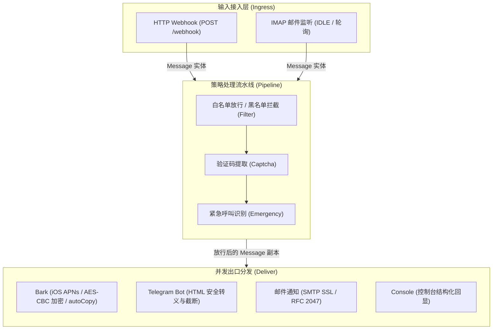

# PushTransfer

[](https://github.com/zapsaang/push-transfer/actions/workflows/ci.yml)
[](https://github.com/zapsaang/push-transfer/actions/workflows/release-image.yml)
[](go.mod)
[](https://www.docker.com/)
[](LICENSE)

`PushTransfer` 是一个面向个人与自建场景的**现代化、轻量级、高性能通知中转与过滤网关**（基于 Go 语言实现）。

它可以接收来自 Android 设备（如 [SmsForwarder 短信转发器](https://github.com/pppscn/SmsForwarder)）上报的短信、未接来电，或监听 IMAP 邮箱的触发邮件。消息在经过白名单放行、黑名单过滤、验证码提取与紧急呼叫标记等策略流水线后，并发分发至 **Bark (iOS APNs)**、**Telegram Bot**、**邮件 (SMTP SSL)** 以及控制台。

---

## 目录

- [核心架构](#核心架构)
- [核心特性](#核心特性)
- [快速开始](#快速开始)
- [部署指南](#部署指南)
  - [方式一：Docker / Docker Compose 部署（推荐）](#方式一docker--docker-compose-部署推荐)
  - [方式二：二进制编译运行](#方式二二进制编译运行)
  - [方式三：Systemd 系统服务托管](#方式三systemd-系统服务托管)
- [配置说明](#配置说明)
  - [环境变量一览表](#环境变量一览表)
  - [正则规则配置指南 (JSON 数组)](#正则规则配置指南-json-数组)
  - [Bark 端到端加密配置](#bark-端到端加密配置)
- [客户端接入指南](#客户端接入指南)
  - [1. Webhook 接口规范](#1-webhook-接口规范)
  - [2. 多凭据接入配置 (AUTH_CREDENTIALS)](#2-多凭据接入配置-auth_credentials)
  - [3. 短信转发器 (SmsForwarder) 接入示例](#3-短信转发器-smsforwarder-接入示例)
  - [4. IMAP 邮件触发接入](#4-imap-邮件触发接入)
- [运维与验证](#运维与验证)
- [开发与测试](#开发与测试)

---

## 核心架构

系统采用「输入端适配 (Ingress) → 策略流水线 (Pipeline) → 多渠道扇出 (Deliver)」的三层解耦架构：



---

## 核心特性

- **高效轻量**：纯 Go 原生实现，构建为静态单一二进制文件，无外部动态链接依赖，容器镜像体积小（基于 Alpine），运行时内存占用低。
- **多渠道并发投递**：
  - **Bark (iOS)**：支持多设备 Key、自定义推送服务器、关键警告（`critical` 级别强提醒音量）、自动复制验证码（`autoCopy`），以及基于 AES-128-CBC 每消息动态随机 IV 的端到端密文推送（`ciphertext` 与 `iv` 两个独立参数，完全对齐 Bark 官方密文协议）。
  - **Telegram Bot**：支持自定义反向代理 API 地址、HTML 排版富文本渲染、实体标签防截断安全清洗与超长文本防御。
  - **SMTP 邮件**：支持 SSL/TLS 直连、RFC 2047 标题编码清洗与 CRLF 注入防护。
  - **Console 回显**：无外部分发目标时自动回退为控制台输出，便于本地调试。
- **防御性安全设计**：
  - **多凭据恒定时间比对**：每台设备可持有独立的 Bearer Token 或 HTTP Basic 凭据，凭据比对采用 `crypto/subtle.ConstantTimeCompare` 并对全部凭据做无短路全量扫描，杜绝时序攻击（Timing Attack）。
  - **受信代理与真实 IP 提取**：默认仅信任回环与私网反向代理，支持自定义 `TRUSTED_PROXIES`，防止客户端伪造 `X-Forwarded-For`。
  - **DoS 与 OOM 防御**：Webhook 限制请求体最大 1MB，防止大报文内存耗尽；正则引擎对每次匹配施加 500ms 超时熔断（`regexp2` 回溯超时），遇到 ReDoS 型恶意输入时返回错误而非拖垮进程。
- **高可靠 IMAP 邮件触发**：
  - 优先使用 IMAP IDLE 长连接接收新邮件，兼容无 IDLE 支持的服务商自动降级轮询。
  - 具备指数退避重试、毒丸邮件（Poison Pill）死信隔离与至少一次（At-Least-Once）消费保障。
- **优雅退出 (Graceful Shutdown)**：对称纳管 HTTP 服务与后台 IMAP 协程生命周期，收到系统中断信号（SIGINT/SIGTERM）后平滑释放资源与连接。

---

## 快速开始

### 1 分钟跑通

```bash
# 1. 克隆仓库
git clone https://github.com/zapsaang/push-transfer.git
cd push-transfer

# 2. 编译二进制
go build -ldflags="-s -w" -o push-transfer ./cmd/push-transfer

# 3. 显式选择运行模式（必填：webhook | imap | both）
export RUN_MODE=webhook

# 4. 配置一个仅用于本地演示的凭据（不要用于生产）
export AUTH_CREDENTIALS='[{"name":"dev","token":"dev-token-change-me"}]'

# 5. 启动服务（默认监听 8889 端口，无外部通道时默认回显至控制台）
./push-transfer
```

在另一终端发送一条测试短信消息：

```bash
curl -X POST http://localhost:8889/webhook \
  -H "Content-Type: application/json" \
  -H "Authorization: Bearer dev-token-change-me" \
  -d '{
    "msg_type": "text",
    "title": "10086",
    "content": "【中国移动】您的验证码是 889900，请勿泄露给他人。",
    "timestamp": 1729000000
  }'
```

观察服务端终端输出，控制台将打印接收并格式化后的消息日志（以下为真实运行输出，`text` 内的时间按进程本地时区渲染）：

```text
time=2026-10-16T20:53:36.606+08:00 level=INFO msg="incoming request" ip=127.0.0.1 method=POST path=/webhook
time=2026-10-16T20:53:36.606+08:00 level=INFO msg="webhook authorized" ip=127.0.0.1 credential=dev
time=2026-10-16T20:53:36.606+08:00 level=INFO msg="console deliver" msg_type=text title=10086 content="【中国移动】您的验证码是 889900，请勿泄露给他人。" captcha="" emergency=false text="【中国移动】您的验证码是 889900，请勿泄露给他人。\n\n短信来自: 10086\n\n发送时间：2024-10-15 21:46:40\n转发时间：2024-10-15 21:46:40\n"
```

> - `RUN_MODE` 必填，未设置或非法值 fail-fast，不会猜测模式。
> - `/healthz` **仅在** `webhook` / `both` 模式下提供；`imap` 模式不监听任何 HTTP。
> - 本网关不存在无鉴权服务模式；上述 `captcha` 为空是因为快速开始未配置任何 `REGEX_*` 规则，配置 `REGEX_CAPTCHA` 后该字段会填入提取到的验证码。

---

## 部署指南

### 方式一：Docker / Docker Compose 部署（推荐）

#### 1. 准备配置文件

复制模板生成 `.env` 配置文件：
```bash
cp .env.example .env
# 按需修改 .env 中的配置项（如 BARK_DEVICE_KEY_LIST、AUTH_CREDENTIALS 等）
vim .env
```

#### 2. 使用 Docker Compose

在项目根目录创建 `docker-compose.yml`：

```yaml
services:
  push-transfer:
    build:
      context: .
      dockerfile: Dockerfile
    image: ghcr.io/zapsaang/push-transfer:latest
    container_name: push-transfer
    restart: unless-stopped
    ports:
      - "8889:8889"
    env_file:
      - .env
    security_opt:
      - no-new-privileges:true
```

启动容器：
```bash
docker compose up -d
```

查看日志与运行状态：
```bash
docker compose logs -f
```

#### 3. 单命令 Docker 运行

如果不需要使用 Docker Compose，可以直接构建并运行容器：

```bash
# 构建镜像
docker build -t push-transfer:latest .

# 启动容器
docker run -d \
  --name push-transfer \
  --restart unless-stopped \
  -p 8889:8889 \
  --env-file .env \
  push-transfer:latest
```

---

### 方式二：二进制编译运行

#### 环境要求
- Go 1.26.8 或更高版本（与 [`go.mod`](go.mod) 中的 `go` 指令一致）
- Linux / macOS / Windows

#### 编译并运行

```bash
# 静态编译并去除调试符号以压缩体积
CGO_ENABLED=0 go build -ldflags="-s -w" -o push-transfer ./cmd/push-transfer

# 指定环境变量或导出 .env 后运行
export RUN_MODE=webhook
export PORT=8889
export AUTH_CREDENTIALS='[{"name":"phone-a","token":"your_secure_token"}]'
export BARK_DEVICE_KEY_LIST="your_bark_device_key"

./push-transfer
```

#### 交叉编译（以部署至 Linux AMD64 服务器为例）

```bash
CGO_ENABLED=0 GOOS=linux GOARCH=amd64 go build -ldflags="-s -w" -o push-transfer-linux-amd64 ./cmd/push-transfer
```

---

### 方式三：Systemd 系统服务托管

适用于 Linux 独立虚拟机或裸金属服务器，确保开机自启与异常自动拉起。

1. 将编译好的二进制文件复制到 `/usr/local/bin`：
   ```bash
   sudo cp push-transfer /usr/local/bin/push-transfer
   sudo chmod +x /usr/local/bin/push-transfer
   ```

2. 创建运行配置目录与文件：
   ```bash
   sudo mkdir -p /etc/push-transfer
   sudo cp .env.example /etc/push-transfer/push-transfer.env
   sudo chmod 600 /etc/push-transfer/push-transfer.env
   sudo vim /etc/push-transfer/push-transfer.env
   ```

3. 创建 Systemd 服务文件 `/etc/systemd/system/push-transfer.service`：
   ```ini
   [Unit]
   Description=PushTransfer Notification Gateway
   After=network.target

   [Service]
   Type=simple
   EnvironmentFile=/etc/push-transfer/push-transfer.env
   ExecStart=/usr/local/bin/push-transfer
   Restart=always
   RestartSec=5s
   LimitNOFILE=65535

   # 安全强化沙箱（可选）
   NoNewPrivileges=true
   ProtectSystem=full
   ProtectHome=true

   [Install]
   WantedBy=multi-user.target
   ```

4. 启动服务并设置自启动：
   ```bash
   sudo systemctl daemon-reload
   sudo systemctl enable --now push-transfer
   sudo systemctl status push-transfer
   ```

---

## 配置说明

PushTransfer 遵循 **12-Factor 原则**，所有配置均通过环境变量进行注入。配置模板详见 [`.env.example`](.env.example)。

### 环境变量一览表

#### 1. 服务监听与运行模式
| 环境变量 | 默认值 | 说明 |
|----------|--------|------|
| `RUN_MODE` | _(必填，无默认)_ | 进程运行模式枚举（大小写不敏感，三选一）：<br>• `webhook`：只启动 HTTP 服务（`/webhook` + `/healthz`），要求 `AUTH_CREDENTIALS` 含至少一条可用凭据，忽略 `EMAIL_TRIGGER_*`（若存在则输出 `WARN`）<br>• `imap`：只启动 IMAP 后台监听，**不监听任何 HTTP 端口**，要求完整 `EMAIL_TRIGGER_LOGIN_EMAIL` + `EMAIL_TRIGGER_PASSWORD`，且若同时配置了 `AUTH_CREDENTIALS` 会 fail-fast 报错<br>• `both`：同时启动 HTTP 服务与 IMAP 监听，要求凭据与完整 IMAP 配置同时具备<br>未设置或传入其他值（含旧版 `RUN_TRIGGER` 布尔值）时启动即报错退出 |
| `PORT` | `8889` | HTTP Webhook 服务监听端口（兼容别名 `SERVER_PORT`；仅 `RUN_MODE=webhook` 或 `both` 时生效） |

#### 2. Webhook 接入鉴权与网络代理
| 环境变量 | 默认值 | 说明 |
|----------|--------|------|
| `AUTH_CREDENTIALS` | _(空)_ | **唯一**凭据来源：单行严格 JSON 数组，每项支持 `name`（审计标识）、`token`、`username`、`password`。同一 token 或同一组 username+password 只能出现一次，重复即启动报错。`RUN_MODE=webhook` 或 `both` 时必填；`RUN_MODE=imap` 时禁止配置。详见[多凭据接入配置](#2-多凭据接入配置-auth_credentials) |
| `TRUSTED_PROXIES` | _(空)_ | 信任的反向代理 IP 或 CIDR 列表（逗号分隔，如 `10.0.0.0/8,192.168.1.1`，兼容别名 `WEBHOOK_TRUSTED_PROXIES`）。默认已自动信任 Loopback 与 RFC 1918 私网地址。仅当直连对端属于受信代理时才解析 `X-Forwarded-For`/`X-Real-IP`，并从右向左跳过受信代理取第一个非受信地址，避免客户端伪造 |

#### 3. Bark 投递通道
| 环境变量 | 默认值 | 说明 |
|----------|--------|------|
| `BARK_DEVICE_KEY_LIST` | _(空)_ | Bark 设备 Key 列表（逗号分隔，如 `key1,key2`） |
| `BARK_URL_LIST` | _(空)_ | Bark 完整推送 Webhook URL 列表（逗号分隔，适用于自建 Bark 服务器） |
| `BARK_POST_URL` | `https://api.day.app/push` | Bark API 推送入口（若配置了历史 `BARK_GET_URL`，系统将自动推导尾缀 `/push`） |
| `AES_128_ECB_KEY` | _(空)_ | Bark 密文推送密钥，**必须恰好 16 个 ASCII 字符**（Bark 客户端按字符数校验并以原始 UTF-8 字节作为密钥；含多字节字符的 16 字节密钥无法在 App 中录入，会在启动时直接报错）。配置后自动开启 AES 加密 |

#### 4. Telegram 投递通道
| 环境变量 | 默认值 | 说明 |
|----------|--------|------|
| `TELEGRAM_BOT_TOKEN` | _(空)_ | Telegram Bot Token（从 [@BotFather](https://t.me/BotFather) 获取） |
| `TELEGRAM_CHAT_ID` | _(空)_ | 接收通知的 Chat ID（整数，个人 ID 或群组 ID，从 [@userinfobot](https://t.me/userinfobot) 获取） |
| `TELEGRAM_API_URL` | `https://api.telegram.org` | Telegram API 基址（支持本地反代，如 `https://tg-proxy.example.com`，兼容 `TELEGRAM_BASE_URL`） |

#### 5. 邮件投递通道 (SMTP SSL)
| 环境变量 | 默认值 | 说明 |
|----------|--------|------|
| `EMAIL_DELIVER_SENDER_EMAIL` | _(空)_ | 发件人邮箱地址 |
| `EMAIL_DELIVER_RECEIVER_EMAIL` | _(空)_ | 收件人邮箱地址 |
| `EMAIL_DELIVER_PASSWORD` | _(空)_ | 发件人邮箱授权码 / 密码 |
| `EMAIL_DELIVER_SMTP_SERVER` | `smtp.exmail.qq.com` | SMTP 服务器域名 |
| `EMAIL_DELIVER_SMTP_PORT` | `465` | SMTP SSL 端口 |

#### 6. 邮件触发通道 (IMAP SSL，需 `RUN_MODE=imap` 或 `both`)
| 环境变量 | 默认值 | 说明 |
|----------|--------|------|
| `EMAIL_TRIGGER_LOGIN_EMAIL` | _(空)_ | IMAP 登录邮箱地址 |
| `EMAIL_TRIGGER_PASSWORD` | _(空)_ | IMAP 登录授权码 / 密码 |
| `EMAIL_TRIGGER_IMAP_SERVER` | `imap.exmail.qq.com` | IMAP 服务器域名 |
| `EMAIL_TRIGGER_IMAP_PORT` | `993` | IMAP SSL 端口 |
| `EMAIL_TRIGGER_MAILBOX` | `INBOX` | 监听的邮箱文件夹目录 |

#### 7. 规则流水线 (正则过滤与提取)
| 环境变量 | 默认值 | 说明 |
|----------|--------|------|
| `REGEX_FILTER_WHITE` | `[]` | 白名单正则列表（**JSON 字符串数组**）。命中立即放行，跳过黑名单 |
| `REGEX_FILTER_BLACK` | `[]` | 黑名单正则列表（**JSON 字符串数组**）。命中即拦截拒收 |
| `REGEX_CAPTCHA` | `[]` | 验证码提取正则列表（**JSON 字符串数组**）。优先提取第 1 捕获组 |
| `REGEX_EMERGENCY` | `[]` | 紧急通知识别正则列表（**JSON 字符串数组**）。命中则 Bark 设为 critical 强提醒 |

---

### 正则规则配置指南 (JSON 数组)

> [!IMPORTANT]
> 由于正则表达式常包含逗号（如数量词 `\d{4,6}`）、反斜杠等特殊字符，所有 `REGEX_*` 规则**必须使用标准 JSON 字符串数组格式**，不能使用普通逗号分隔。

在编写环境变量时，注意 JSON 内部字符串的反斜杠转义：
- 正则 `\d{4,6}` 在 JSON 中需写为 `"\\d{4,6}"`。
- 支持高级正则语法（如大小写不敏感 `(?i)`、前瞻与后顾零宽断言等）。

#### 配置示例

```env
# 1. 白名单规则：来自银行、官方服务或包含“重要”的内容直接放行
REGEX_FILTER_WHITE=["(?i)招商银行", "(?i)工商银行", "紧急通知"]

# 2. 黑名单规则：包含营销推广、退订回T等垃圾短信直接丢弃
REGEX_FILTER_BLACK=["(?i)退[订tdTD]", "回T退订", "理财推荐", "优惠券"]

# 3. 验证码提取：优先使用括号捕获组 (group 1) 提取数字代码
REGEX_CAPTCHA=["(?:验证码|动态码|校验码)[是为：:\\s]+(\\d{4,6})", "(\\d{4,6})[\\s]*(?:为您的验证码|是您的动态码)"]

# 4. 紧急消息标记：包含“告警”、“紧急”、“故障”时标记为 emergency
REGEX_EMERGENCY=["(?i)alert", "故障告警", "系统崩溃", "紧急呼叫"]
```

---

### Bark 端到端加密配置

PushTransfer 实现了 Bark 官方兼容的 AES 加密推送机制：
- 使用 **AES-128-CBC** 算法，明文为完整推送参数的 JSON 字符串，密文使用标准 Base64。
- **动态随机 IV**：每条消息即时生成 16 字节密码学随机数，并以 16 个 ASCII 字符的形式作为**独立的 `iv` 参数**与 `ciphertext` 一起发送，彻底消除静态 IV 复用风险。
- **协议契约**：Bark 客户端读取顶层 `ciphertext` 与 `iv` 两个独立字段，**不会**从密文前缀中截取 IV。因此把 IV 拼接进 `ciphertext`（或只发送 `ciphertext`）会导致收到通知时显示 `Decryption Failed`。仓库内 `internal/crypto` 的单元测试直接使用 Bark 官方文档给出的密文向量做互操作回归。
- **密钥要求**：`AES_128_ECB_KEY` 必须恰好为 **16 个 ASCII 字符**（如 `1234567890123456`）。
- **废弃说明**：已废弃旧版本中的静态 `AES_128_ECB_IV` 配置，即使传入也会被安全忽略并在启动时告警。

---

## 客户端接入指南

### 1. Webhook 接口规范

#### 接口地址
`POST /webhook`

#### 请求头 (Headers)
```http
Content-Type: application/json
Authorization: Bearer <你的 token>   # AUTH_CREDENTIALS 中某个条目的 token
# 或使用 HTTP Basic Auth: Authorization: Basic <base64(user:pass)>
```

#### 请求报文格式 (JSON Payload)

```json
{
  "msg_type": "text",
  "title": "10086",
  "content": "【中国移动】尊敬的客户，您的验证码为 654321，5分钟内有效。",
  "battery_level": 85,
  "timestamp": 1729000000,
  "send_time": 1729000000,
  "receive_time": 1729000005
}
```

#### 核心字段说明

| 字段 | 类型 | 是否必填 | 说明 |
|------|------|----------|------|
| `msg_type` | string | 是 | 消息类型：`text`（短信，走规则流水线）或 `call`（来电，无条件放行） |
| `title` | string | 是 | 标题或消息来源（如发件人号码、来电人姓名/号码） |
| `content` | string | 否 | 短信正文内容（`call` 类型可为空） |
| `battery_level` | int | 否 | 发送端设备当前剩余电量百分比（如 `85`） |
| `timestamp` | int/str | 否 | 时间戳。系统具备防御性容错，自动兼容毫秒（13位）、秒（10位）、字符串数字或 `null` |
| `send_time` | int/str | 否 | 消息实际发送时间戳（备选回退字段） |
| `receive_time` | int/str | 否 | 转发端设备接收时间戳（备选回退字段） |

#### 接口响应状态码

| HTTP Code | 响应体示例 | 场景说明 |
|-----------|------------|----------|
| `200 OK` | `{"status":"success"}` | 消息处理并通过流水线，已成功投递下游 |
| `200 OK` | `{"status":"blocked"}` | 消息命中黑名单规则，已被网关正常拦截过滤 |
| `400 Bad Request` | `{"status":"failed","message":"invalid json"}` | 报文不是合法的 JSON 格式 |
| `401 Unauthorized`| `{"status":"failed","message":"unauthorized"}` | Bearer Token / Basic Auth 认证失败（配置 Basic Auth 时附带 `WWW-Authenticate: Basic` 质询；多凭据下响应不区分具体失败凭据以避免枚举） |
| `405 Method Not Allowed` | `{"status":"failed","message":"method not allowed"}` | 请求方法不为 `POST` |
| `413 Request Entity Too Large` | `{"status":"failed","message":"request body too large"}` | 请求体体积超过 1MB 上限 |
| `500 Internal Server Error` | `{"status":"failed","message":"process failed"}` | 规则流水线执行失败（如正则匹配超时熔断） |
| `502 Bad Gateway` | `{"status":"deliver_failed","message":"..."}` | 下游所有投递通道均请求失败 |

---

### 2. 多凭据接入配置 (AUTH_CREDENTIALS)

针对拥有多台上报设备（如多台 Android 短信转发器、多台测试终端或自动化脚本）的场景，使用 `AUTH_CREDENTIALS` 环境变量以**单行 JSON 数组**配置多组独立凭据。它是**唯一**的 Webhook 凭据来源：

```bash
AUTH_CREDENTIALS='[{"name":"phone-a","token":"random-token-1"},{"name":"tablet","username":"tab-user","password":"tab-password"},{"name":"phone-b","token":"random-token-2","username":"backup-user","password":"backup-password"}]'
```

- **配置契约与字段**：
  - `name`：可选的审计标识，进入结构化审计日志以区分来源设备（如 `level=INFO msg="webhook authorized" ip=... credential=phone-a`）。切勿在 `name` 中包含密码或敏感信息。若缺省则自动命名为 `credential-N`（1-based 序号）；`name` 最大 64 字符。
  - `token`：Bearer Token（可选，与 Basic Auth 至少提供一项；仅接受 `Authorization: Bearer <token>` 请求头，不支持 `?token=` 查询参数）。
  - `username` 与 `password`：HTTP Basic Auth 凭据对，必须成对配置（若仅配置其中一项将报启动错误）。
  - **空白规范化契约**：`name` 与 `token` 会剥离首尾空白；Basic 的 `username`/`password` 按字节原样保存并逐字节比对（RFC 7617 §2.1），客户端必须发送完全相同的值；纯空白字段仍按 V5 拒绝。
  - 每个认证要素必须是**唯一**的：同一个 `token`，或同一组 `username`+`password`，在数组里只能出现一次；重复会在启动时报错，因为一个密钥只能对应一个审计身份，静默去重会让日志出现二义性。
- **校验硬约束（Fail-Fast）**：
  - JSON 必须严格格式化，不支持未知字段或尾随字符；
  - 数组不得为空或 `null`（配置了变量就必须至少包含一条有效凭据）；
  - 单次最多支持配置 64 条凭据；
  - 环境变量必须写在**单行**内，避免被容器或 shell 分行注入截断；
  - 启动校验失败时报错信息只包含变量名、条目序号与出错字段，**绝不回显凭据内容**（避免密钥进入日志）。
- **无隐式开放入口**：
  - 进程若需要对外提供 Webhook（即 `RUN_MODE=webhook` 或 `RUN_MODE=both`），就必须配置 `AUTH_CREDENTIALS`，否则**启动即失败退出**，不会以无鉴权方式监听端口。
  - 唯一允许无凭据运行的模式是纯 IMAP 模式：`RUN_MODE=imap`（不监听 HTTP；此时若传入 `AUTH_CREDENTIALS` 同样会 fail-fast 报错，提示改用 `RUN_MODE=both` 或移除未使用的凭据）。
  - 旧版的 `RUN_TRIGGER` / `AUTH_TOKEN` / `AUTH_USERNAME` / `AUTH_PASSWORD` 已**移除**，不再被读取；请显式设置 `RUN_MODE`，并把旧凭据迁移成 `AUTH_CREDENTIALS` 中的一个条目，例如 `[{"name":"legacy","token":"<原 AUTH_TOKEN 值>"}]`。
  - 建议为每台设备颁发独立 Token，便于凭据轮换与日志来源审计。
- **恒定时间安全保障**：
  - 无论配置多少组凭据，鉴权引擎均以 SHA-256 预计算摘要并在请求到达时进行全量扫描比对（无提前 return 短路），杜绝时序攻击（Timing Attack）。

---

### 3. 短信转发器 (SmsForwarder) 接入示例

以 Android 端常用工具 **[SmsForwarder (短信转发器)](https://github.com/pppscn/SmsForwarder)** 为例：

1. 打开应用，进入 **发送通道设置** → 添加 **webhook** 通道。
2. 配置参数：
   - **通道名称**：`PushTransfer 网关`
   - **WebHook 地址**：`http://your-server-ip:8889/webhook`
   - **请求方式 (Method)**：`POST`
   - **请求头 (Headers)**：
     ```text
     Content-Type: application/json
     Authorization: Bearer your_auth_token
     ```
   - **请求体 (Body)**：
     ```json
     {
       "msg_type": "text",
       "title": "[from]",
       "content": "[msg]",
       "timestamp": "[timestamp]",
       "battery_level": [battery]
     }
     ```
3. 来电转发通道请求体模板：
   ```json
   {
     "msg_type": "call",
     "title": "[from]",
     "content": "未接来电通知",
     "timestamp": "[timestamp]",
     "battery_level": [battery]
   }
   ```
4. 点击 **测试**，验证能否收到推送。

---

### 4. IMAP 邮件触发接入

当部署环境无法暴露公网端口接收 Webhook 时，可通过邮件触发模式拉取消息：

1. 在 `.env` 中设置：
   ```env
   RUN_MODE=imap
   EMAIL_TRIGGER_LOGIN_EMAIL=your_worker_email@example.com
   EMAIL_TRIGGER_PASSWORD=your_imap_password
   EMAIL_TRIGGER_IMAP_SERVER=imap.example.com
   EMAIL_TRIGGER_IMAP_PORT=993
   EMAIL_TRIGGER_MAILBOX=INBOX
   ```
2. 任何需要触发推送的客户端，只需向 `EMAIL_TRIGGER_LOGIN_EMAIL` 发送一封邮件：
   - **邮件主题 (Subject)**：必须为 `PushTransfer Email Trigger`（大小写敏感）。
   - **邮件正文 (Body)**：内容为标准 JSON 字符串（格式同 Webhook 请求报文），且邮件为 `text/plain` 纯文本格式。
3. 消费语义：投递成功后自动将该邮件标记为已读（`\Seen`）；投递失败时保持未读并在同一会话内指数退避重试；主题匹配但正文/JSON 永久损坏的毒丸邮件会被标记 `\Seen` 以隔离死信。**主题不匹配的普通邮件不会被修改**（保持原有未读状态）。因此建议为该触发器使用专用邮箱。

---

## 运维与验证

### 健康检查接口

在 `RUN_MODE=webhook` 或 `RUN_MODE=both` 模式下，网关提供专门的存活检测路由，适用于 Docker 容器健康检查或 K8s Liveness 探针（注意：`RUN_MODE=imap` 纯邮件触发模式**不监听任何 HTTP 端口**，不提供 `/healthz`）：

```bash
curl http://localhost:8889/healthz
# 正常返回: {"status":"ok"}，HTTP 200
```

Docker Compose 中增加健康检查示例（仅适用于 `RUN_MODE=webhook` 或 `both`）：
```yaml
healthcheck:
  test: ["CMD-SHELL", "wget -qO- http://127.0.0.1:8889/healthz || exit 1"]
  interval: 30s
  timeout: 5s
  retries: 3
```

### 查看版本号

```bash
./push-transfer -v
# 输出: push-transfer version 1.0.0
```

### 结构化日志

程序内部统一采用 Go 标准库 `log/slog` 输出结构化日志，方便接入 Promtail / Loki、Filebeat 或 Docker 日志收集工具：

```text
time=2026-10-16T18:00:00.000Z level=INFO msg="starting push-transfer gateway" version=1.0.0
time=2026-10-16T18:00:00.000Z level=INFO msg="registered deliver target" name=bark device_keys=1 urls=0
time=2026-10-16T18:00:00.000Z level=INFO msg="starting HTTP webhook server" addr=[::]:8889
```

---

## 开发与测试

在提交代码或对逻辑进行修改时，建议先执行完整的代码静态检查与单测套件（与 CI 门禁一致，见 [`.github/workflows/ci.yml`](.github/workflows/ci.yml)）：

```bash
# 1. 编译静态二进制
go build -v -o push-transfer ./cmd/push-transfer

# 2. 运行严格静态代码扫描 (保持 0 issues)，并校验格式与 vet
golangci-lint run ./...
gofmt -l .          # 必须无输出
go vet ./...        # 必须无输出

# 3. 运行全量单元测试与并发竞态检测 (-race)
go test -race -v -cover ./...
```

每次 push 到 `main` 或提交 Pull Request 都会触发 GitHub Actions 自动执行上述检查
（`gofmt` / `go vet` / `go test -race -cover` / `golangci-lint`）；本地通过不代表 CI 通过，
合并前请以 CI 绿色为准。

---

## 开源协议

本项目基于 [MIT License](LICENSE) 许可协议开源。
